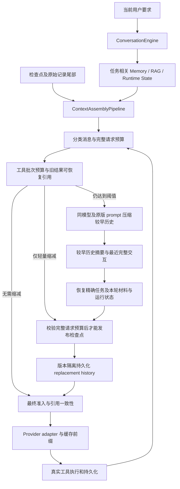

# 上下文管理：从输入到恢复

当前实现以 Codex 公开本地 compaction 为基线，采用持久化 replacement history，并增加工具结果聚合预算与最近完整交互保留。最初迁移见 [迁移说明](../implementation/codex-context-source-migration.md)，当前分层策略与验证见 [第一阶段实现](../implementation/layered-context-phase1-20260929.md)。

Context 是模型投影；History 是原始记录；Memory 是跨任务经验；Runtime State 是真实任务与确认状态。压缩不能改变后面三者，也不能创造用户授权。

自动压缩覆盖 Chat 入模前、Agent 入模前及轮内；手动压缩与状态诊断提供本人会话 API。稳定系统和工具 schemas 位于前缀，动态上下文与运行状态随后追加。缓存只是供应商优化，不替代任何上下文。

旧 summary/cursor 列保留但不驱动生产上下文；首次加载旧会话从完整原始记录重建。失败或过期压缩不发布替换历史。重启后从检查点与持久化尾部恢复。

引用携带 `tool_call_id` 与 `source_turn_id`，通过 `read_file` 分页读取当前会话中属于当前用户的原始结果。没有可靠来源身份的历史结果不做引用替换。轻量预算保护最新工具批次；完整摘要优先保留最近整轮对话，长单轮任务则保留完整助手调用批次。尾部放不进保留预算时交由摘要覆盖，不拆开工具调用与结果。
