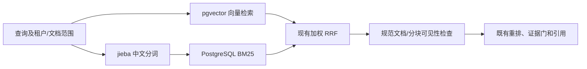

# PostgreSQL + pgvector 混合检索迁移

## 实现

PostgreSQL + pgvector 是唯一检索后端。后续清理已删除 Milvus 实现、后端选择器、回退分支、旧配置和专用容器服务；不再使用 `RAG_VECTOR_BACKEND`。

- 写入、检索、维度验证、outbox 删除、重建及评测均直接使用 `app/rag/pgvector_hybrid.py`。
- `app/rag/pgvector_hybrid.py` 使用 PostgreSQL 原生 `vector` 运算符计算 dense 排序。默认 HNSW；`PGVECTOR_DENSE_INDEX_TYPE=exact` 可采用精确检索。HNSW 使用 iterative scan，最终可见性检查继续保留。
- 中文词法通道使用固定版本 jieba 0.42.1 的 search mode、NFKC、casefold；文档及查询使用同一处理。PostgreSQL 保存 token 频次 JSONB、唯一词数组和文档长度，GIN 加速词交集筛选。
- BM25 在 SQL 内计算，`k1=1.2`、`b=0.75`，IDF 为 `ln(1 + (N-df+0.5)/(df+0.5))`。N、df 和平均长度来自同一查询快照中的用户及文档范围，不使用跨租户全局统计或客户端拟合模型。
- 没有显式 document_id 的全局知识查询在数据库 top-k 之前排除 chat_attachment；不仅依靠返回后的客户端过滤。
- 只有表名的 SHA-256 前缀及固定 SQL 模板进入标识符，输入值通过参数绑定。物理表名小于 PostgreSQL 的 63 字节上限。
- 完整索引 fingerprint 包含模型、维度、分块、中文分析器/BM25 契约和 ANN 配置。切换后端或同维度模型会建立新代际；不复用旧向量空间。
- 单文档向量替换在一个事务内完成，替换操作对同用户/文档串行；验证、分词在删除前完成。数据库写入失败会回滚旧内容。规范事实的发布仍遵循既有 pending→索引→indexed 流程。
- SQL 设置事务内 statement_timeout，与 `RAG_SEARCH_TIMEOUT_SECONDS` 一致，避免上层超时后数据库查询继续长时间占用连接。
- Alembic 0048 将旧 outbox 任务转换为 `knowledge_index_delete` / `knowledge_index_upsert`，同时转换默认删除幂等键；保留任务 ID、状态、负载、尝试次数和锁。运行时不保留旧处理器。

不新增常驻搜索服务，也不依赖第三方 PostgreSQL BM25 二进制扩展。pgvector 本身负责向量，BM25 使用 PostgreSQL SQL、JSONB 和 GIN 组合实现。

## 部署顺序

此代码交付没有操作现有业务数据卷。建议在维护窗口执行迁移，避免新旧 API/worker 同时使用不同后端。

1. 用已有备份脚本备份数据库及所需对象文件：`python scripts/backup.py create --include-objects --postgres-container interview_copilot_db`。pgvector 代际表会随数据库 dump 备份；Milvus 仍可由文档事实重建。
2. 安装更新后的 Python 依赖；新增 jieba。构建 `docker compose build db`。`docker/postgres/Dockerfile` 基于原 `postgres:15.18-alpine` 安装 pgvector 0.8.6，不改变 PostgreSQL 主版本或 Alpine libc。
3. 停止写入及旧 worker，再使用同一配置重建数据库容器。保留 `pgdata` 卷；不要使用 `docker compose down -v`。外部托管 PostgreSQL 则使用供应商支持的 pgvector 安装方式。
4. 移除旧 `RAG_VECTOR_BACKEND` 和 `MILVUS_*` 配置，执行 `python -m alembic upgrade head`（容器部署使用既有 migrate 服务）。0047 在服务器提供 vector 扩展时启用它；旧 0047 的条件安装行为保留在历史迁移中；当前部署必须安装扩展。若已执行过 0047 后才安装扩展，需要数据库管理员执行 `CREATE EXTENSION IF NOT EXISTS vector;`。0048 在旧 API/worker 停止后转换任务名称，完成后才能启动新 worker。运行时缺少扩展会明确报错。
5. 使用相同 embedding 配置运行 `python scripts/reingest_hybrid.py` 从事实重建新代际，也可先用 `--user <id>` 或 `--document <id>` 做小范围验证。正常迁移不需要 `--drop`；旧代际保留可回退。已有 generation reconciliation 也可排队重建过时文档。
6. 运行 `python scripts/consistency_scan.py` 和既有中文 RAG 评测，再启动相同配置的 API、worker、Beat。默认 `--profile full` 不会启动 Milvus、etcd 及 Milvus 专用 MinIO；业务文件 MinIO 保留。

代码内已无 Milvus 回退开关；若必须回退，需停机恢复旧版本代码、匹配的迁移版本和部署配置。历史数据库迁移保留，不能删除迁移链。此次清理不删除机器上已有的数据卷。

若官方 Alpine 包镜像下载很慢，可以显式构建：`docker compose build --build-arg ALPINE_MIRROR=https://mirrors.aliyun.com/alpine db`。默认仍使用官方源，apk 继续校验发行版签名。

## 配置

| 配置 | 默认值 | 用途 |
|---|---|---|
| PGVECTOR_COLLECTION | interview_copilot_rag | 索引逻辑名 |
| PGVECTOR_SIMILARITY_METRIC | IP | IP / COSINE / L2 |
| PGVECTOR_DENSE_INDEX_TYPE | hnsw | hnsw / exact |
| PGVECTOR_HNSW_M | 16 | 图连接数 |
| PGVECTOR_HNSW_EF_CONSTRUCTION | 200 | 建图搜索参数 |
| PGVECTOR_HNSW_EF_SEARCH | 100 | 查询搜索参数 |

HNSW 的 vector 索引最多支持 2000 维；更高维度明确选择 exact 或更低维 embedding，不自动降维。默认 1024 维不受此限制。更改 ANN/分词相关配置会影响索引 fingerprint，应重建对应代际。

## 验证与性能边界

新增 `backend/tests/test_rag/test_pgvector_hybrid.py`：中文/全角词归一化、参数化过滤、同维度模型切换隔离、真实 dense+BM25 双路召回、SQL BM25 与参考公式对照、跨租户分数隔离、附件范围、幂等替换、插入失败回滚、错误向量拒绝、HNSW 查询。

真实数据库测试使用 `TEST_PG_ADMIN_URL` 指定的隔离测试实例，由 fixture 创建和删除独立数据库；不会对业务数据库运行破坏性测试。

2026-09-23 验证结果：

- 自定义 PostgreSQL 15.18 Alpine + pgvector 0.8.6 镜像实际构建成功；基于该镜像启动无业务数据卷的临时实例。
- 新增检索测试共 10 项通过（首轮 9 项，补充空数据库安装扩展测试 1 项）。覆盖上述数据库行为，以及从规范分块重建、发布 fingerprint、消费旧 outbox 删除任务和 Alembic 自动启用扩展。
- RAG、知识库、记忆、索引一致性回归共 232 项通过、1 项跳过；跳过项依赖 live Milvus + reranker，新增 PostgreSQL 测试没有跳过。
- 独立真实 PostgreSQL 记忆测试 2 项通过；修改的 Python 文件 Ruff 和 `git diff --check` 通过。Compose full 配置校验通过，默认服务列表不包含 Milvus。
- 未切换业务容器、重建业务索引或运行真实 embedding/reranker 质量评测；这些仍属于部署验收。

功能等价指具备向量＋中文 BM25＋融合＋重排完整链路，不表示与 Milvus 的分词、语料统计范围或近似搜索结果逐条相同。每次查询计算 BM25 范围统计具有成本；大型单租户语料需要用实际规模做 EXPLAIN/延迟和召回评测，再决定是否引入事务维护的统计表。此交付不凭小型测试宣称大规模性能提高，也不更改已有 reranker 阈值以掩盖召回质量差异。

参考：[pgvector 官方文档](https://github.com/pgvector/pgvector)、[jieba 0.42.1](https://pypi.org/project/jieba/0.42.1/)。

## 后续旧逻辑清理

删除 Milvus 适配器、PyMilvus 依赖、双后端工厂、专用维度/过滤测试和永远跳过的占位测试。删除仅由测试调用的 insert/hybrid_search 包装；测试改用文档原子替换及生产候选检索入口。重建工具移除退休简历索引删除选项及只有一个值的 --only 分派。启动/安装脚本只启动 PostgreSQL、Redis、业务 MinIO；增加数据库镜像构建。

评测语料准备与发布指纹已改用 pgvector，巡检输出使用 missing_in_index / stale_in_index，备份不再输出旧 Milvus 字段。保留仍由迁移工具读取的旧记忆模型和来源巡检，不删除用户历史数据。

清理后验证：RAG、知识、脚本、worker 和记忆回归 273 项通过；真实 pgvector + 旧任务迁移 11 项通过；真实记忆 PostgreSQL 测试 2 项通过。扩展评测合并运行共 90 通过、2 失败，失败来自既有场景清单引用不存在的前端 ManualInvitationForm.test.tsx 和 ConnectionsPage.test.tsx，未修改这些清单或用删除断言掩盖失败。Ruff、Compose 校验和重建 CLI 检查通过。旧容器数据卷未操作，临时测试容器已停止。
